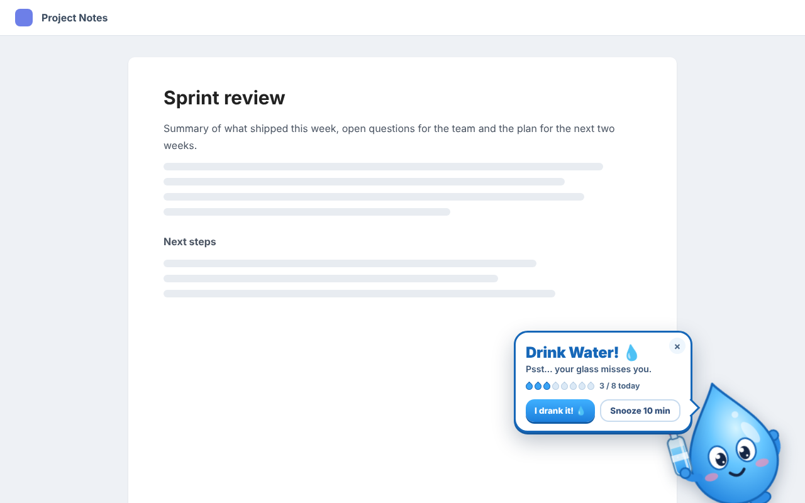
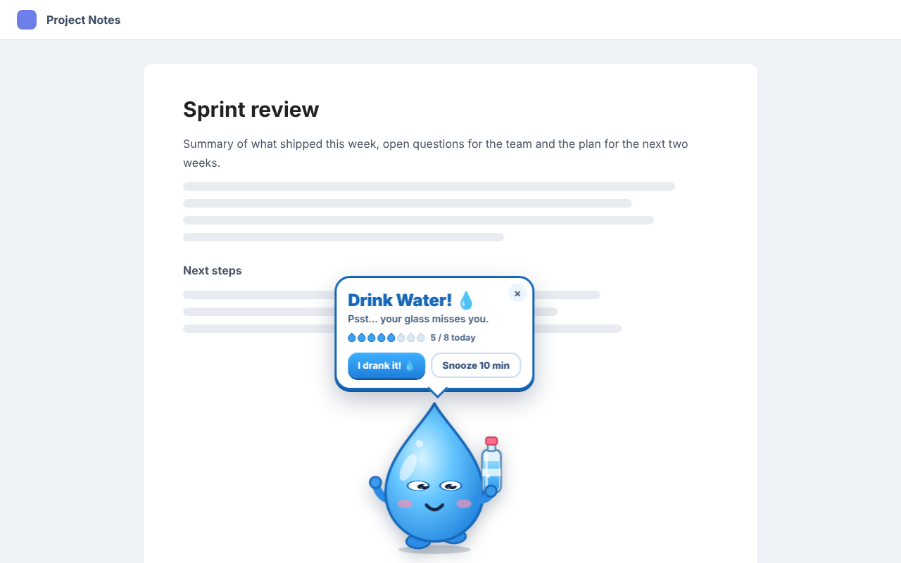
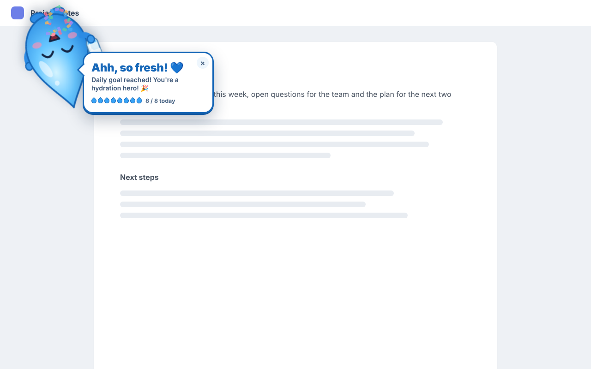
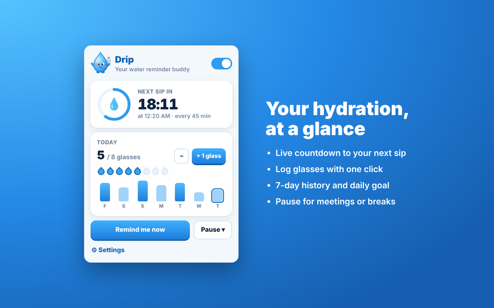

# Drip – Water Reminder Buddy (Chrome extension)

An animated water-drop character reminds you to drink water while you work in Chrome.

**Live on the Chrome Web Store:** https://chromewebstore.google.com/detail/bobiejbclkhkedlomeknkenaaanbdogd

## Screenshots

| Peek | Walk across | Goal reached |
|---|---|---|
|  |  |  |



## What's in this folder

```
drip/
├── extension/            ← the extension itself (this is what you load in Chrome / upload to the store)
│   ├── manifest.json     ← extension definition (Manifest V3), permissions, icons
│   ├── icons/             ← toolbar/store icons (PNG) and their SVG sources, mascot.svg
│   └── src/
│       ├── background.js         ← service worker: timer, snooze, pause, idle, active hours, badge, notifications
│       ├── shared/settings.js    ← default settings, validation, storage helpers, active-hours maths
│       ├── shared/theme.css      ← shared styles for popup and settings page
│       ├── content/overlay.js    ← the animated character (peek + walk), speech bubble, buttons
│       ├── offscreen/            ← plays the sound effects (works even before you click the page)
│       ├── popup/                ← toolbar popup: countdown, today's glasses, 7-day history, pause
│       └── options/              ← settings page and first-run welcome screen
├── store/                ← everything for the Chrome Web Store
│   ├── listing.md        ← description, category, permission justifications (copy-paste)
│   ├── privacy-policy.md / privacy-policy.html
│   └── images/            ← 128 icon, 4 screenshots (1280×800), promo tiles
└── tools/make-icons.mjs  ← re-renders the PNG icons from the SVGs (only needed if you change the icon)
```

## Default behaviour

| Setting | Default |
|---|---|
| Interval | 45 min (1–240 allowed) |
| Snooze | 10 min |
| Animation | Random: peek from a corner or walk across the bottom |
| Peek auto-hide | 25 s if you don't react (hovering keeps it open) |
| Daily goal | 8 glasses of 250 ml |
| Away detection | No reminders while the screen is locked or after 5 min without input; reminds you 1 min after you're back |
| Chrome not focused | System notification with "I drank water" and "Snooze" buttons |
| Pages that can't show Drip (chrome://, Chrome Web Store, PDF viewer, New Tab) | System notification |

How the timer works: the next reminder is always scheduled when one appears. "I drank it!" (or "+1 glass" in the popup) restarts the full interval. "Snooze" sets the next reminder to the snooze length. Ignoring or closing the reminder keeps the normal interval.

## Install

**From the Chrome Web Store (recommended):** open the [Store listing](https://chromewebstore.google.com/detail/bobiejbclkhkedlomeknkenaaanbdogd) and click **Add to Chrome**.

**From source (for development or testing changes):**

1. Clone or download this repository.
2. Open Chrome and go to `chrome://extensions`.
3. Turn on **Developer mode** (switch at the top right).
4. Click **Load unpacked** and select the `extension` folder (the one that contains `manifest.json`).
5. A welcome tab opens. Click **Show me a peek** to see Drip.
6. Pin the extension: click the puzzle-piece icon in the toolbar → click the pin next to **Drip**.

Keep the `extension` folder where it is. Chrome loads it from that location every time it starts. If you delete or move it, the extension stops working.

## Test it

1. Open any normal website (for example wikipedia.org).
2. Click the Drip icon → **Remind me now**. Drip appears on the page.
3. Try the buttons:
   - **I drank it!** → Drip drinks and celebrates, the glass count goes up, the toolbar badge shows the count, the timer restarts.
   - **Snooze 10 min** → Drip falls asleep and leaves, the popup shows "Snoozed".
   - **×** → Drip leaves, the timer is unchanged.
   - Click on Drip himself for a reaction.
4. Test the real timer quickly: open Drip **Settings** → set **Remind me every** to `1` min → wait one minute while you stay on a website. Set it back to 45 afterwards.
5. Try both animations in Settings → **Character** → **Preview peek / Preview walk**, and pick **Peek**, **Walk** or **Surprise me**.
6. Switch to another app (for example a terminal) and wait for a reminder: you get a system notification instead, since an extension can only draw inside Chrome, never over another application.
7. Try **Pause** in the popup and check that the badge shows `zz`.
8. If Drip doesn't appear at the expected time, check Settings → **Schedule** → **"Only remind during active hours"** isn't on with a window that excludes the current time — that setting silently suppresses reminders outside the window by design.

If something doesn't work, open `chrome://extensions`, find Drip, and click **service worker** (under "Inspect views") to see its console, or click **Errors** if that button appears.

After you edit any file, click the reload arrow on the Drip card in `chrome://extensions`. Pages that were already open need a refresh only if you changed `overlay.js`.

## Publishing updates to the Chrome Web Store

Drip is already published (link at the top). For a new version:

1. **Bump the version.** Increase `"version"` in `extension/manifest.json` (for example `1.0.0` → `1.0.1`). The Chrome Web Store rejects an upload whose version isn't higher than the live one.
2. **Rebuild the upload zip.** The zip must have `manifest.json` at its top level:
   ```bash
   cd extension
   zip -r ../drip-extension-1.0.1.zip . -x "*.DS_Store"
   ```
   `cd` moves into the extension folder. `zip -r` adds every file in it (`.`) recursively, and writes the zip one folder up (`../`). `-x "*.DS_Store"` skips macOS junk files if any exist.
3. In the [Developer Dashboard](https://chrome.google.com/webstore/devconsole), open the Drip item → **Package** tab → upload the new zip.
4. Review the **Store listing** and **Privacy practices** tabs — update them if anything changed (see `store/listing.md` for the copy-paste text).
5. Click **Submit for review**.

